# Arquitetura multiplayer do UNO

> Rascunho para discussão. O diagrama registra a direção atual da arquitetura; detalhes ainda podem mudar durante a implementação.

```mermaid
%%{init: {"theme":"dark","themeVariables":{"background":"#0B1020","lineColor":"#94A3B8","textColor":"#E2E8F0"}}}%%
flowchart LR
    UI["Interface<br/>ChatPanel + MesaUI"]:::ui

    subgraph APP["GameManager · Autoload em cada peer"]
        direction TB
        ROUTER["SceneRouter<br/>troca as telas"]:::local
        BUS["EventBus<br/>comandos e eventos locais"]:::local

        subgraph NETWORK["NetworkManager"]
            direction TB
            PEER["Conexão e ciclo dos peers<br/>entrada / saída"]:::network
            CHAT["ChatEndpoint<br/>Node · RPCs do chat"]:::network
            MATCH["MatchEndpoint<br/>Node · RPCs da partida"]:::network
        end
    end

    subgraph GAME["Partida · estado autoritativo no servidor"]
        direction TB
        API["Mesa_Api<br/>recebe comandos e valida regras"]:::logic
        TABLE["Mesa_Logica<br/>jogadores · mãos · descarte · turno"]:::state
        CARD["Classes Carta_*<br/>executam o efeito da carta"]:::logic
        EFFECTS["Efeitos_Api<br/>contexto para alterar o estado"]:::logic

        API -->|"consulta / atualiza"| TABLE
        API -->|"aplica efeito"| CARD
        CARD -->|"chama operações"| EFFECTS
        EFFECTS -->|"altera o estado"| TABLE
    end

    RPC["Godot RPC / ENet<br/>comunicação entre os peers"]:::network
    PLAYERS["Todos os peers<br/>incluindo quem enviou a ação"]:::peers

    UI -->|"mensagem de chat"| CHAT
    UI -->|"jogar · comprar · passar"| BUS
    BUS -->|"encaminha comandos"| MATCH

    PEER -->|"entrada / saída de jogador"| API
    MATCH -->|"pedido recebido no servidor"| API
    API -->|"resultado + eventos ordenados"| MATCH

    CHAT <-->|"mensagens de chat"| RPC
    MATCH <-->|"comandos e eventos da partida"| RPC
    RPC <-->|"broadcast ou envio direcionado"| PLAYERS

    CHAT -->|"avisa localmente"| BUS
    MATCH -->|"avisa localmente"| BUS
    BUS -->|"atualiza a interface"| UI
    ROUTER -->|"carrega"| UI

    classDef ui fill:#E0F2FE,stroke:#0284C7,color:#0C4A6E
    classDef local fill:#E2E8F0,stroke:#64748B,color:#1E293B
    classDef network fill:#DBEAFE,stroke:#3B82F6,color:#1E3A8A
    classDef logic fill:#F3E8FF,stroke:#9333EA,color:#581C87
    classDef state fill:#D1FAE5,stroke:#059669,color:#064E3B
    classDef peers fill:#FEF3C7,stroke:#D97706,color:#78350F
```

## Ideias registradas

- `GameManager` permanece entre cenas e contém o roteamento de telas, o `EventBus` local e o `NetworkManager`.
- `ChatEndpoint` e `MatchEndpoint` separam os RPCs de chat dos RPCs da partida.
- O servidor valida e altera o estado autoritativo da partida. A `Mesa_Logica` guarda jogadores, mãos, descarte e turno; `Mesa_Api` recebe comandos e coordena as regras.
- As cartas chamam operações de efeito pelo `Efeitos_Api`. Essa classe participa da lógica local e não transmite pela rede.
- Depois de uma ação aceita, a camada de rede distribui o resultado e os eventos ordenados. O `EventBus` avisa a interface local; os RPCs comunicam os peers.
- Eventos públicos vão para todos. Informações privadas, como a mão de um jogador, são enviadas apenas ao destinatário correto.

## Estado da implementação

- `GameManager` é um autoload com `EventBus`, `NetworkManager` e `MatchEndpoint` em caminhos iguais nas duas instâncias.
- `NetworkManager` abre ou conecta por ENet, apresenta o cliente e associa o peer remoto ao jogador 2. O anfitrião participa como jogador 1.
- `MatchEndpoint` encaminha comandos à `Mesa_Api` somente no anfitrião. Cada evento volta aos dois jogadores na mesma ordem; os dados privados são incluídos apenas na entrega ao dono da mão.
- `VisibilidadeEventos` aplica a mesma filtragem por jogador na rede e na prévia local. Eventos destinados apenas a uma pessoa não são enviados ao outro jogador.
- `partida_rede.tscn` oferece uma entrada simples por nome, IP e porta. A partida começa assim que o segundo jogador confirma a conexão.
- A cena local `scenes/tests/previa_mesa_partida.tscn` continua disponível para revisar a interface sem rede.
- A cena `teste.tscn` é o laboratório de objetos e usa o baralho completo por padrão. A partida configura o mesmo `Baralho_Logico` com as cartas já implementadas; ambos usam `comprar_carta()`, que repõe a composição configurada quando o monte esgota.
- A partida básica entre duas instâncias em localhost foi validada manualmente no Godot.
- As cartas especiais coloridas `PULA`, `INVERTE` e `+2` e os coringas `TROCACOR` e `+4` participam do baralho. Troca de mãos, chat, lobby completo e reconexão permanecem para as próximas etapas.

## Regra de compra da partida básica

- No começo da vez, o jogador pode jogar uma carta da própria mão ou começar a comprar.
- Depois da primeira compra, só pode jogar a carta jogável recém-comprada. Se a carta não for jogável, continua comprando até encontrar uma jogável.
- Ao encontrar uma carta jogável, escolhe entre jogá-la e passar a vez. Não pode comprar outra carta nesse momento.
- Se o monte esgotar, o `Baralho_Logico` cria outro baralho da mesma composição da partida. O descarte permanece como está.
- O servidor informa publicamente a quantidade comprada e se o jogador está decidindo entre jogar e passar. A identidade da carta comprada continua privada.
- A mesa calcula os IDs de cartas que o jogador pode jogar e os envia apenas a ele. A mão usa essa lista para escurecer as demais cartas sem interromper as animações.
- A distribuição inicial alterna uma carta por jogador até cada um ter sete. Compra voluntária e penalidade usam a mesma operação da mesa para entregar cada carta.
- Cada entrega gera um `CartaRecebida` próprio, enviado em um RPC confiável. O evento informa publicamente quem recebeu e a nova quantidade da mão; os dados da carta chegam somente ao dono. A interface espaça o início das animações sem alterar os tweens da carta.

## Regras das cartas especiais coloridas

- A partida começa com uma carta numérica no descarte. O baralho contém números, `PULA`, `INVERTE`, `+2`, `TROCACOR` e `+4`.
- Uma carta especial combina com a cor ou com o símbolo da carta do topo.
- `PULA` salta o próximo jogador. Com dois jogadores, quem jogou recebe outra vez.
- `INVERTE` muda o sentido da mesa e, com dois jogadores, também salta o adversário.
- Cada `+2` soma dois à pilha pública de compra. O jogador seguinte pode rebater com qualquer `+2` ou clicar no monte para comprar a pilha e perder a vez.
- O `+4` soma quatro à pilha e pede uma cor antes de passar a vez. Pode rebater outro `+4`, mas não pode ser jogado sobre um `+2`. Um `+2` rebate um `+4` somente se combinar com a cor escolhida para ele; a partir daí, o topo é `+2` e continua a regra dos `+2`.
- Comprar a pilha é uma penalidade separada da compra voluntária: nenhuma das cartas recebidas pode ser jogada nesse turno. Se o monte esgotar durante a penalidade, o baralho repõe as cartas e a entrega continua.
- Quando a última carta da mão é uma especial, seu efeito ocorre antes de encerrar a partida. Se for `+2` ou `+4`, o próximo jogador compra a pilha automaticamente, sem nova oportunidade de rebater, e a partida termina. No caso do `+4`, a cor é escolhida antes dessa compra.
- Os efeitos e as quantidades compradas são eventos públicos ordenados; as identidades das cartas compradas continuam privadas.

## Escolha de cor

- `TROCACOR` pode ser jogada em qualquer cor, exceto enquanto houver uma pilha de compra pendente. O `+4` também é coringa, mas não pode ser jogado sobre um `+2`.
- Após `CartaJogada`, a mesa aguarda a escolha de quem jogou. O servidor publica `EscolhaCorSolicitada`; comandos de jogo ficam bloqueados até receber uma das quatro cores válidas.
- A escolha altera a cor do objeto lógico identificado pelo ID. O topo do descarte passa a ser a referência de cor das próximas jogadas, sem uma segunda cor guardada na mesa.
- `CorDaCartaAlterada` informa ID e cor a todos se a carta estiver no descarte; se estiver em uma mão, só o dono recebe o evento. Uma carta ainda no monte é alterada apenas no servidor e será entregue com a nova cor quando for comprada.
- A `Carta` visual recebe a alteração pelo ID e anima seu próprio fundo. A regra de perder o efeito especial ao deixar de ser preta fica para uma etapa posterior.
- Se o coringa foi a última carta da mão, a escolha é resolvida antes de `PartidaEncerrada`.
